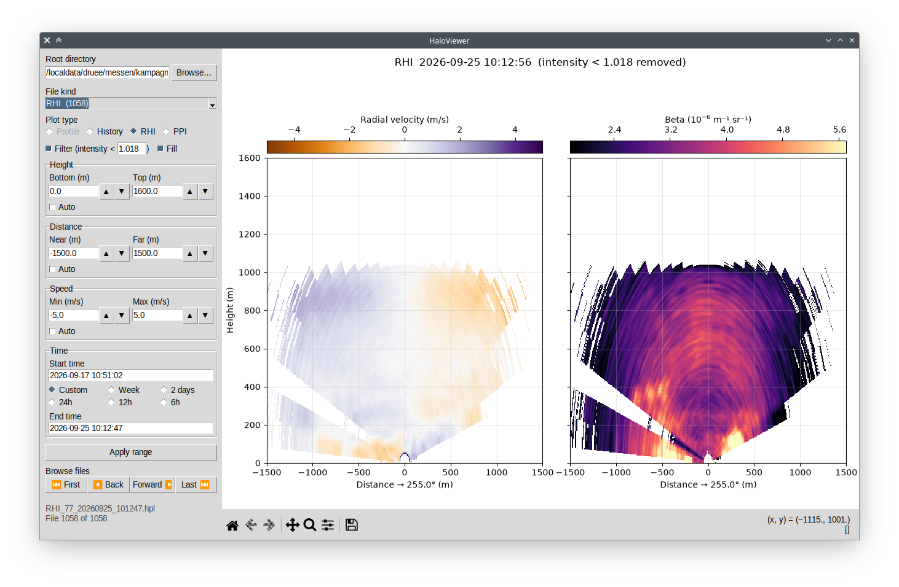

.. HaloViewer documentation master file

==========
HaloViewer
==========

A viewer and plotting toolkit for Halo Photonics wind lidar data
(``.hpl`` files) covering the **processed-product** tree
(``Proc/YYYY/YYYYMM/YYYYMMDD/*.hpl``). Every kind found there is
plottable: the instrument-processed **Processed Wind Profile** (a
single scan's height/speed/direction profile, or many combined into a
height/time History image), and the raw regular-scan kinds --
**VAD**, **Stare**, **Wind Profile** and **RHI** -- each of which gets
a distance/time intensity+beta History image built from their raw
per-gate data (no instrument-processed profile of their own), plus two
single-scan views of radial velocity and beta: **RHI** (the scan's
points projected onto the vertical plane along the first ray's
azimuth) and **PPI** (projected onto the horizontal plane), each drawn
as dots or, optionally, filled by inverse-distance-weighted interpolation.
Any other kind found on disk is still listed (so you can see what's in
your data tree) but reported as not yet implemented.

|docs-badge| |pypi-badge| |source-badge|

.. |docs-badge| image:: https://img.shields.io/badge/docs-GitLab%20Pages-blue
   :target: https://uwm.gitlab-pages.uni-trier.de/lidar/haloviewer/
   :alt: Documentation

.. |pypi-badge| image:: https://img.shields.io/pypi/v/HaloViewer
   :target: https://pypi.org/project/HaloViewer/
   :alt: PyPI

.. |source-badge| image:: https://img.shields.io/badge/source-GitHub-181717?logo=github
   :target: https://github.com/cdruee/haloviewer
   :alt: Source code

         velocity and beta side by side, with the settings panel on
         the left.

   The graphic viewer (``haloviewer``) showing one RHI scan with the
   intensity filter and Fill switched on.

Installation
------------

Conda (recommended -- minimal footprint on top of miniconda)
~~~~~~~~~~~~~~~~~~~~~~~~~~~~~~~~~~~~~~~~~~~~~~~~~~~~~~~~~~~~

.. code:: bash

   conda env create -f environment.yml
   conda activate haloviewer

This only adds ``numpy``, ``pandas``, ``matplotlib`` and ``scipy`` on top
of a base Python; the GUI toolkit (Tkinter) ships with the standard
``python`` conda package on Linux, macOS and Windows, so nothing extra is
needed for the GUI itself. Tested against Python 3.9+ on Ubuntu 22.04,
24.04 and 26.04, macOS and Windows.

Plain pip
~~~~~~~~~

.. code:: bash

   pip install -e .

(On some minimal Linux distributions Tkinter is a separate OS package,
e.g. ``sudo apt install python3-tk`` on Debian/Ubuntu -- not needed when
using the conda environment above, since conda's ``python`` package
already includes it.)

To build this documentation as well, install the ``docs`` extra and run
Sphinx from the project root; the HTML ends up in ``build/html/``:

.. code:: bash

   pip install -e ".[docs]"
   sphinx-build -b html docs build/html

Contents
--------

HaloViewer provides four ways to work with the data. Each has its own
page with the details.

Graphic viewer -- ``haloviewer``
~~~~~~~~~~~~~~~~~~~~~~~~~~~~~~~~

A Tkinter desktop application for browsing a ``Proc`` tree: pick a
directory, a file kind and a plot type (*Profile*, *History*, *RHI* or
*PPI*), then step through single files or whole time windows, with
adjustable height, distance and speed ranges. See :doc:`viewer`.

.. code:: bash

   haloviewer /path/to/Data/Proc

Command-line tool -- ``haloplot``
~~~~~~~~~~~~~~~~~~~~~~~~~~~~~~~~~

Plots files, directories or glob patterns straight to an image file,
without the GUI. File kind, plot mode and time range are inferred where
possible and can be set explicitly. See :doc:`cli`.

.. code:: bash

   haloplot Proc/2026/202609 --kind RHI --start 24h -p rhi_24h.png

Sync tool -- ``halosync``
~~~~~~~~~~~~~~~~~~~~~~~~~

A separate GUI for selectively copying the ``Metek``, ``Proc`` and
``Raw`` trees from the lidar control PC to a backup or analysis disk.
It skips files that are already there, leaves out the file the lidar is
still writing, and can run on a fixed schedule. See :doc:`sync`.

.. code:: bash

   halosync

Python API -- ``haloviewer.plot()``
~~~~~~~~~~~~~~~~~~~~~~~~~~~~~~~~~~~

The same functionality as ``haloplot`` for scripts and notebooks. It
returns a matplotlib :class:`~matplotlib.figure.Figure` for further
customisation. See :doc:`api`.

.. code:: python

   import haloviewer
   fig = haloviewer.plot("Proc/2026/202609/20260919",
                         kind="Processed_Wind_Profile", start="24h")

Design
------

How the code is organised (modules, scan cache and settings, version
numbers), how to add support for further scan kinds, and how to run the
tests is described in :doc:`design`.

.. toctree::
   :maxdepth: 2
   :hidden:

   viewer
   cli
   sync
   api
   design

Licence
-------

|product| is licensed under the European Union Public Licence v1.2
(EUPL-1.2); see the ``LICENSE`` file in the project root for the full
licence text.

``haloviewer/hpl.py`` is adapted from the ``hpl`` module of
`cdruee/python-readmet <https://github.com/cdruee/python-readmet>`_,
which is itself licensed under the EUPL-1.2.

Copyright
---------

|copyright|

Developed with support of Anthropic Claude Opus 5.5.
